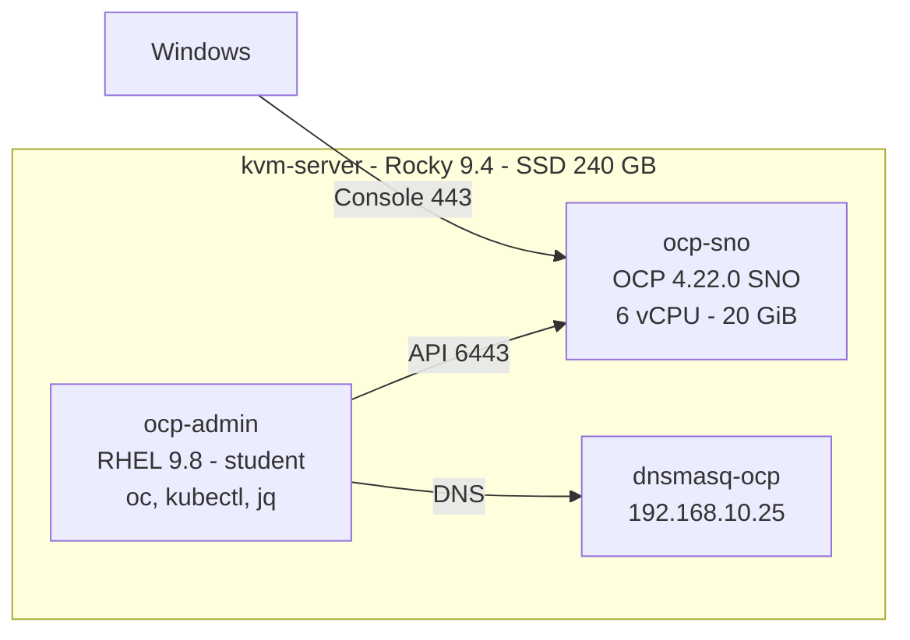

# Academia de Comandos: OpenShift

[](https://github.com/eduardoandradej/academia-comandos-openshift/actions/workflows/validate-docs.yml)


Prática intensiva de `oc`, `kubectl` e administração do OpenShift 4.22: comandos explicados, exercícios
progressivos, desafios, troubleshooting e repetição deliberada em um HomeLab Single Node OpenShift.

> **Projeto de aprendizagem independente.** Não é material oficial, não reproduz roteiros, scripts `lab` nem a grade
> da Red Hat e não substitui cursos, infraestrutura, documentação ou certificação. OpenShift e Red Hat são marcas da
> Red Hat, Inc.

## O que é (e o que não é)

| Repositório | Foco |
|---|---|
| [openshift-do180-4.22-estudos](https://github.com/eduardoandradej/openshift-do180-4.22-estudos) | estudo por **capítulo** do DO180 |
| [openshift-do280-4.22-estudos](https://github.com/eduardoandradej/openshift-do280-4.22-estudos) | estudo por **capítulo** do DO280 |
| **Academia de Comandos** (este) | **domínio operacional** por família de comando: executar, repetir, diagnosticar e limpar até virar memória muscular |

Cada exercício tem: objetivo verificável, contexto e perfil, pré-flight, conceito, comandos guiados com cada flag
comentada, repetições, **desafio sem pista**, **diagnóstico controlado**, validação, **limpeza segura**, gabarito
**separado** e ficha de revisão espaçada.

## Estado atual (honesto)

| Item | Atual | Meta |
|---|---:|---:|
| Trilhas completas | 4 (00 a 03) | 21 |
| Microexercícios | 60 | 300+ |
| Cenários de troubleshooting | 12 | 40+ |
| Comandos e formas catalogados | 235 | 200+ |
| Fichas de comando | 18 | — |

Status dos exercícios: **proposto** — escritos e revisados estaticamente (Markdown, YAML, shell, links, testes
offline), mas **ainda não executados contra o cluster** pelo autor. A validação acontece quando você os executa.

## Arquitetura do HomeLab



Detalhes e limites em [docs/01-topologia-homelab.md](docs/01-topologia-homelab.md).

## Início rápido

```bash
# na ocp-admin, como student
git clone https://github.com/eduardoandradej/academia-comandos-openshift.git ~/academia-comandos-openshift
cd ~/academia-comandos-openshift
scripts/academy doctor          # verificação SOMENTE LEITURA
scripts/academy list            # exercícios e cenários
scripts/academy show ORI-001    # enunciado (sem gabarito)
```

Comece pela [Trilha 00](trilhas/00-orientacao/README.md). O **ORI-004** cria perfis `developer` e `admin` em
kubeconfigs próprios — o kubeconfig do instalador (`system:admin`) fica reservado para recuperação.

## Trilhas

| ID | Trilha | Status |
|---|---|---|
| 00 | [Orientação e segurança](trilhas/00-orientacao/README.md) | disponível |
| 01 | [Navegação e CLI](trilhas/01-cli/README.md) | disponível |
| 02 | [Leitura e inspeção](trilhas/02-consultas/README.md) | disponível |
| 03 | [Projetos e metadados](trilhas/03-projetos/README.md) | disponível |
| 04–20 | [Pods, Deployments, Services, Routes, Config, Storage, Imagens, Resiliência, Declarativo, Kustomize, Helm, RBAC, Rede, Administração, Operadores, Troubleshooting, Desafios](trilhas/README.md) | planejadas |

## Restrições do HomeLab

- **Um único nó**: nada de drain, cordon, reboot ou upgrade pela Academia.
- **Recursos compartilhados**: quota por projeto de laboratório (500m CPU / 768 Mi de requests), no máximo 2 réplicas.
- **SSD limitado**: manter > 20 GiB livres em `/var` do `kvm-server`; nada de workloads que gravem muito.
- **Sem StorageClass, registry privado, IdM ou LoadBalancer**: exercícios dependentes são marcados **REQUER PREPARAÇÃO** ou **NÃO DISPONÍVEL NO HOME LAB ATUAL**.
- **Componentes críticos intocáveis**: nenhuma mutação em `openshift-*`, `kube-*`, OAuth, nó ou host.

## Segurança

Semáforo **VERDE / AMARELO / VERMELHO**, projetos `acNN-*`, rótulo `academy.openshift.dev/managed-by=academia` e
scripts que simulam por padrão. Veja [docs/02-preflight-e-seguranca.md](docs/02-preflight-e-seguranca.md) e
[SECURITY.md](SECURITY.md). Nenhum kubeconfig, token, pull secret ou senha real deve entrar neste repositório.

## Modos de prática

Repetição 5× / 10× / 20×, flash, reverso, comparação, incidente, operador e revisão espaçada (D+1, D+3, D+7, D+14,
D+30). Veja [docs/05-metodologia-repeticao.md](docs/05-metodologia-repeticao.md).

## Mapa do repositório

| Caminho | Conteúdo |
|---|---|
| [`docs/`](docs/00-iniciar-aqui.md) | topologia, segurança, identidades, diferenças da sala oficial, metodologia, roteiros DO180/DO280, troubleshooting, backup |
| [`catalogo/`](catalogo/indice-comandos.md) | índice de comandos, famílias e comparações, erros frequentes, matriz de competências, fichas |
| [`trilhas/`](trilhas/README.md) | exercícios por trilha |
| [`cenarios/`](cenarios/troubleshooting/README.md) | cenários de troubleshooting |
| [`solucoes/`](solucoes/README.md) | gabaritos (separados de propósito) |
| [`manifests/`](manifests/README.md) | baseline de quota e alvos de observação |
| [`scripts/`](scripts/README.md) | `academy`, preflight, status, safe-cleanup, perfis |
| [`templates/`](templates/exercicio.md) | modelos de exercício, gabarito, ficha e revisão |
| [`progresso/`](progresso/README.md) | modelo de revisão (preencha fora do repositório) |
| [`tests/`](tests/run-tests.sh) | testes offline dos scripts com `oc` simulado |

## Contribuir

Veja [CONTRIBUTING.md](CONTRIBUTING.md). Licença: [Apache-2.0](LICENSE) — aplica-se apenas ao conteúdo original deste repositório.
