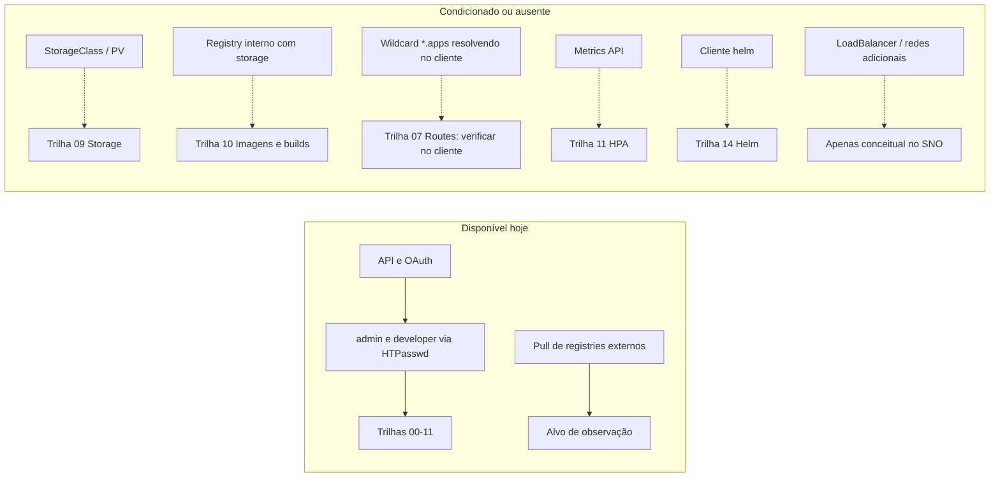

# Matriz de competências

> Para cada família: onde se aprende a **explicar**, **observar**, **executar**, **diagnosticar** e **revisar**, quais
> pré-requisitos o HomeLab precisa e o risco típico. "—" = ainda não produzido (trilha planejada).

## Progresso do repositório

| Meta | Atual | Alvo |
|---|---:|---:|
| Comandos e formas catalogados | 235 (231 distintos) | 200+ ✔ |
| Microexercícios originais | 180 | 300+ |
| Cenários de troubleshooting | 36 | 40+ |
| Fichas de comando | 33 | uma por família de comando |
| Trilhas completas | 12 de 21 | 21 |

## Matriz por família

| Família | Explicar | Observar | Executar | Diagnosticar | Revisar | Pré-requisitos | Risco |
|---|---|---|---|---|---|---|---|
| Ambiente e identidade | ORI-001, ORI-002 | ORI-002, ORI-003 | ORI-004 | TS-001 | ORI-009 | HTPasswd `homelab-users` | VERDE/AMARELO |
| Saúde do cluster | ORI-005, ORI-006 | ORI-006, ORI-007, ORI-008 | — (somente leitura) | ORI-007, ORI-008, TS-002 | ORI-009 | perfil `admin`; métricas | VERDE |
| Risco e permissão | ORI-010 | ORI-013 | ORI-014 | TS-003 | ORI-010 | — | VERDE |
| Projetos e cotas | ORI-011, ORI-012 | ORI-013 | ORI-011, ORI-012, ORI-015 | ORI-011, ORI-015 | ORI-015 | `admin` para quota | AMARELO |
| Sessão e kubeconfig | CLI-004, CLI-006 | CLI-005, CLI-006 | CLI-004, CLI-009 | TS-004, TS-005 | CLI-015 | ORI-004 | AMARELO (local) |
| Projetos e contexto | CLI-007, CLI-008 | CLI-007 | CLI-007, CLI-008 | TS-006 | CLI-015 | — | AMARELO |
| Ferramentas da CLI | CLI-002, CLI-003, CLI-012 | CLI-011 | CLI-003, CLI-012 | CLI-011, CLI-014 | CLI-015 | `bash-completion` | VERDE/AMARELO (local) |
| Tipos e esquemas | CON-001, CON-002 | CON-001, CON-002 | — | TS-007 | CON-015 | — | VERDE |
| Consulta e formatos | CON-004, CON-007 | CON-004 a CON-011 | CON-003 | CON-006, CON-009, TS-008 | CON-015 | imagem externa (alvo) | VERDE |
| Eventos e espera | CON-012, CON-014 | CON-012, CON-013 | CON-014 | CON-014, TS-009 | CON-015 | imagem externa (alvo) | VERDE/AMARELO |
| Rótulos e anotações | PRJ-003, PRJ-005 | PRJ-001, PRJ-007 | PRJ-003 a PRJ-006, PRJ-014 | PRJ-004, TS-012 | PRJ-015 | — | AMARELO |
| Seletores e donos | PRJ-008, PRJ-009 | PRJ-013 | PRJ-008, PRJ-009 | TS-010 | PRJ-015 | imagem externa | AMARELO |
| Ciclo de vida e versões | PRJ-010, PRJ-011 | PRJ-010, PRJ-011 | PRJ-011, PRJ-012 | PRJ-010, TS-011 | PRJ-015 | — | AMARELO |
| Pods: ciclo de vida | POD-001, POD-003 | POD-002, POD-014 | POD-002, POD-003, POD-011 | TS-013, TS-014 | POD-015 | imagem externa | AMARELO |
| Pods: logs e acesso | POD-004, POD-010 | POD-004, POD-005 | POD-006 a POD-009, POD-013 | POD-004, POD-013 | POD-015 | imagem externa | VERDE/AMARELO |
| Pods: recursos e QoS | POD-012 | POD-012 | POD-012 | TS-015 | POD-015 | imagem externa | AMARELO |
| Deployments e rollout | DEP-001, DEP-003, DEP-007 | DEP-008, DEP-014 | DEP-001 a DEP-007, DEP-013 | DEP-014, TS-016, TS-018 | DEP-015 | imagem externa | AMARELO |
| Jobs, CronJobs, DaemonSets | DEP-010 a DEP-012 | DEP-012 | DEP-009 a DEP-012 | DEP-010, TS-017 | DEP-015 | imagem externa | AMARELO |
| Services e DNS | SVC-001, SVC-002, SVC-005 | SVC-003, SVC-005, SVC-007 | SVC-001, SVC-002, SVC-006, SVC-008 a SVC-012 | SVC-014, TS-019 a TS-021 | SVC-015 | imagem externa | AMARELO |
| Routes e Ingress | RTE-001, RTE-002, RTE-006 | RTE-005, RTE-013 | RTE-001 a RTE-012 | RTE-014, TS-022 a TS-024 | RTE-015 | wildcard `*.apps` resolvendo | AMARELO |
| ConfigMaps e Secrets | CFG-001, CFG-004, CFG-005 | CFG-003, CFG-014 | CFG-001 a CFG-013 | CFG-004, TS-025 a TS-027 | CFG-015 | imagem externa | AMARELO |
| Storage | STO-001, STO-007, STO-011 | STO-006 | STO-002 a STO-005; STO-008 a STO-013 (REQUER PREPARAÇÃO) | STO-014, TS-028 a TS-030 | STO-015 | PV/PVC: **REQUER PREPARAÇÃO** (docs/10) | AMARELO |
| Imagens e registry | IMG-001, IMG-003, IMG-005 | IMG-002, IMG-010, IMG-011 | IMG-004 a IMG-009, IMG-012, IMG-013 | IMG-014, TS-031 a TS-033 | IMG-015 | registry interno desligado: `Local`/builds REQUER PREPARAÇÃO | AMARELO |
| Resiliência e HPA | RES-001, RES-004, RES-007 | RES-002, RES-003, RES-012 | RES-004 a RES-011, RES-013 | RES-014, TS-034 a TS-036 | RES-015 | Metrics API (HPA) | AMARELO |
| Declarativo, Kustomize, Helm | parcial: ORI-012, ORI-014 | — | — | — | — | `helm` (REQUER PREPARAÇÃO) | AMARELO |
| RBAC e identidade | parcial: ORI-003 | — | — | — | — | `admin`; usuários DO280 só no exercício | AMARELO/VERMELHO |
| Rede e isolamento | parcial: CLI-014 | — | — | — | — | — | AMARELO |
| Operadores e manutenção | parcial: ORI-007 | ORI-007 | — (somente observação) | — | — | — | VERDE |

## Mapa de dependências do HomeLab

Legenda: setas contínuas = dependência atendida no último checkpoint; tracejadas = **REQUER PREPARAÇÃO** ou
**NÃO DISPONÍVEL NO HOME LAB ATUAL**. Confirme o estado real com `scripts/preflight.sh` (seção 7).
