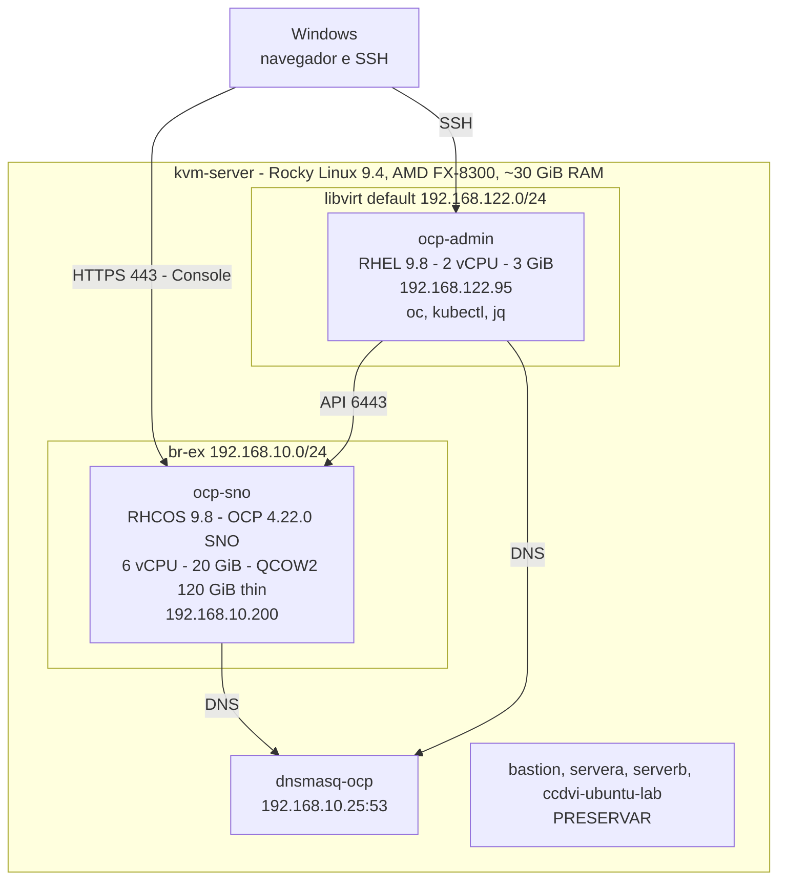

# Topologia do HomeLab

> Dados do checkpoint de instalação (28/10/2026). São **históricos**: confirme o estado atual com `scripts/preflight.sh`.

## Arquitetura

A `ocp-admin` **administra** o cluster; não é worker nem control plane. Todos os exercícios rodam nela, como `student`.

## Endpoints

| Função | Valor |
|---|---|
| API | `https://api.ocp.example.lab:6443` |
| Console | `https://console-openshift-console.apps.ocp.example.lab` |
| OAuth | `oauth-openshift.apps.ocp.example.lab` |
| Wildcard de Routes | `*.apps.ocp.example.lab` → `192.168.10.200` (no DNS interno) |
| Nó | `ocp-sno.ocp.example.lab` |
| DNS do cluster | `192.168.10.25` (`dnsmasq-ocp` no `kvm-server`) |

No Windows, o arquivo `hosts` **não aceita curinga**: cada nova Route acessada pelo navegador precisa de uma linha
própria (ou de um DNS que resolva `*.apps`). Na `ocp-admin`, o resolvedor usa o DNS interno.

## Recursos e limites

| Recurso | Valor | Consequência para a Academia |
|---|---|---|
| CPU do SNO | 6 vCPU, compartilhados com control plane e operadores | quota de laboratório: `requests.cpu` 500m por projeto |
| Memória do SNO | 20 GiB (uso real ~60% no checkpoint) | quota: `requests.memory` 768 Mi; não praticar com memória > 85% |
| Disco do SNO | QCOW2 de 120 GiB thin no SSD de 240 GB | nada de workloads que gravem muito; PVCs proibidos na quota |
| `/var` do `kvm-server` | ~169 GiB, compartilhado com outras VMs | manter **> 20 GiB livres** (`preflight.sh --kvm-ssh`) |
| StorageClass / PVC | 0 / 0 | Trilha 09 **REQUER PREPARAÇÃO** ([10-preparacao-storage.md](10-preparacao-storage.md)) |
| Registry interno | sem armazenamento persistente configurado | builds/push internos condicionados ao `managementState` |
| Prometheus | sem PVC | métricas se perdem em reinícios; `Available=True` não implica histórico |
| Nós | 1 (control plane + worker) | **nunca** drain, cordon, reboot ou upgrade pela Academia |

## O que não existe aqui (e existe na sala de aula oficial)

Registry privado, Git, IdM/LDAP, NFS, utilitários `classroom`/`utility`, LoadBalancer e múltiplos nós. Exercícios
que dependam deles são marcados **REQUER PREPARAÇÃO** ou **NÃO DISPONÍVEL NO HOME LAB ATUAL**. Veja
[04-diferencas-do-ambiente-redhat.md](04-diferencas-do-ambiente-redhat.md).
