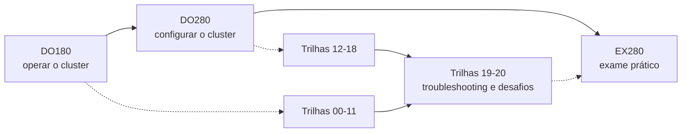

# Roteiro DO280 → Academia

> *Red Hat OpenShift Administration II: Configuring a Production Cluster* (DO280), 4.22. Capítulos estudados em
> [openshift-do280-4.22-estudos](https://github.com/eduardoandradej/openshift-do280-4.22-estudos).

| Tema DO280 | Trilhas da Academia | Observação no SNO |
|---|---|---|
| Gerenciamento declarativo de recursos | 12 (base em ORI-012, ORI-014, PRJ-012) | — |
| Kustomize, templates e Helm | 13, 14 | `helm` REQUER PREPARAÇÃO |
| Autenticação (HTPasswd) e RBAC | 15 (base em ORI-003) | não pré-criar usuários do exercício |
| Segurança de rede e TLS | 07 (TLS em Routes: RTE-006 a RTE-009), 16 | wildcard `*.apps` no cliente |
| LoadBalancer e redes adicionais | 16 | **somente conceitual** |
| Quotas, limit ranges e autosserviço de projetos | 17 (base em ORI-011 a ORI-013, PRJ-002, PRJ-014) | — |
| Operators e OLM | 18 | disponível — **somente observação** |
| SCC, service accounts, Jobs/CronJobs | 05 (Jobs/CronJobs: DEP-010, DEP-011), 17 | SCC só em observação e casos limitados |
| Atualização do cluster | 18 | **somente conceitual/observação**; `oc adm upgrade` só sem argumentos (exibe); nunca `--to` |

## Jornada DO180 → DO280 → EX280

A Academia ajuda a ganhar **velocidade e precisão no terminal**, o que é útil para um exame prático. Ela não
reproduz o exame, não sabe seu conteúdo e não garante aprovação. Consulte os objetivos oficiais do exame publicados
pela Red Hat.
