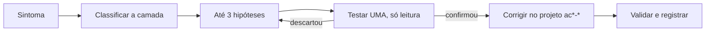

# Método de troubleshooting

## Ciclo

## Camadas e primeiros comandos

| Camada | Pergunta | Primeiro comando |
|---|---|---|
| Sessão | quem sou? a sessão vale? | `oc whoami` |
| Permissão | posso? | `oc auth can-i <verbo> <recurso> -n <ns>` |
| Escopo | estou no lugar certo? | `oc project -q`; `-n` explícito |
| Tipo | o tipo existe? | `oc api-resources \| grep -i <tipo>` |
| Rede | resolve? conecta? | `getent ahostsv4 <host>`; `/dev/tcp` |
| Admissão | o servidor aceitou? | mensagem do `apply`/`create`; `--dry-run=server` |
| Agendamento | o pod tem onde rodar? | `oc describe pod` (Events) |
| Execução | o contêiner sobe? | `oc logs`, `oc logs --previous` |
| Tráfego | o Service encontra os pods? | `oc get endpointslices`; `oc describe svc` |

## Regras

- Leia a mensagem inteira; ela costuma dizer camada, objeto e motivo.
- Eventos primeiro (`oc describe`, `oc get events --sort-by=.metadata.creationTimestamp`).
- Compare com um caso saudável (no HomeLab, o alvo `obs-web`).
- Nunca "resolva" alterando `openshift-*`, o nó, o OAuth ou removendo finalizers.
- Registre causa, evidência e correção na ficha de revisão.

## Material

- Biblioteca de mensagens: [catalogo/erros-frequentes.md](../catalogo/erros-frequentes.md).
- Cenários: [cenarios/troubleshooting/](../cenarios/troubleshooting/README.md) (36 de 40 planejados).
